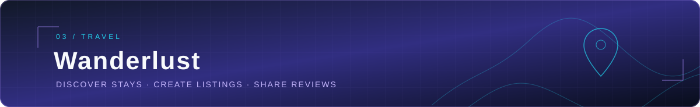
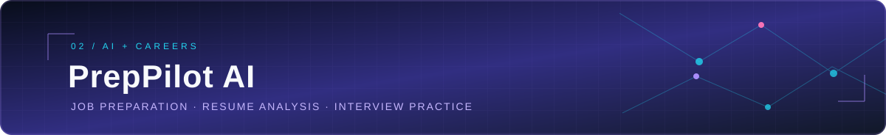
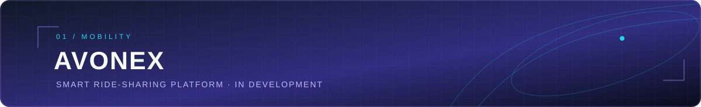

  

  
  

  
  

## 👋 About me

I’m **Vinay**, a Full Stack Developer and B.Tech Computer Science & Engineering student at **Kanpur Institute of Technology**.

I build complete digital products—from polished, responsive interfaces to secure APIs, databases, authentication, and AI-powered workflows. I care about clean architecture, thoughtful user experience, and software that solves real problems.

> Currently crafting **AVONEX**, a smart ride-sharing platform.

## 🚀 Featured work

  

### Wanderlust
**Travel accommodation platform for discovering, listing, and managing stays.**

- Full CRUD experience for property listings with image uploads
- User profiles, favourites, reviews, Mapbox maps, and Razorpay payments
- Built with authentication and MongoDB-backed data models

  
  
  
  
  
  

<a href="https://github.com/Vinay99199/Wanderlust"><strong>View repository →</strong></a>

  

### PrepPilot AI
**AI-powered career preparation and resume intelligence platform.**

- Resume and job-description analysis with skill-gap insights
- AI-generated interview questions and reports
- ATS-focused resume generation and downloadable PDF reports

  
  
  
  
  
  

<a href="https://github.com/Vinay99199/prep-pilot-ai"><strong>View repository →</strong></a>

  

### AVONEX
**A smart ride-sharing platform connecting passengers and drivers.**

- Authentication, driver applications, and an admin approval flow
- Ride creation and discovery, seat booking, and availability management
- Designed for a scalable React and MERN architecture

  
  
  
  
  
  

<a href="https://github.com/Vinay99199/ride-share"><strong>View repository →</strong></a>

## 🧰 Technology

  
  
  

  
  
  

## 🎓 Background

- **Full Stack Development Intern** — CodeAlpha
- **B.Tech, Computer Science &amp; Engineering** — Kanpur Institute of Technology

## 🤝 Let’s connect

  Open to internships, collaborations, and impactful full-stack opportunities.
    
  
  

  

