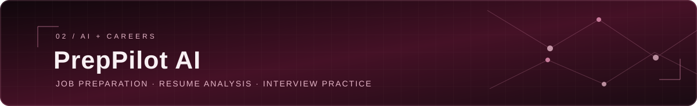

  

  
  

## About

I’m Vinay, a full stack developer and B.Tech Computer Science & Engineering student at Kanpur Institute of Technology. I enjoy building practical web products—from responsive interfaces and backend APIs to database-backed features, authentication, and useful AI-powered applications.

I’m currently developing **AVONEX**, a ride-sharing platform, and exploring how thoughtful software can solve everyday problems.

## Selected work

  

An in-development platform aiming to connect passengers and drivers.

- Authentication, driver applications, and an admin approval flow
- Ride creation and search, seat booking, and seat availability management

  
  
  
  
  
  

<a href="https://github.com/Vinay99199/ride-share">Explore AVONEX on GitHub →</a>

  

An AI-assisted job-preparation app that helps users connect their resume to a target role.

- Resume and job-description analysis with skill-gap identification
- AI-generated interview questions and reports
- ATS-oriented resume generation and PDF export

  
  
  
  
  
  

<a href="https://github.com/Vinay99199/prep-pilot-ai">Explore PrepPilot AI on GitHub →</a>

  

A travel listings application for exploring and managing accommodation.

- Listing management, image uploads, and reviews
- User profiles and favourites, map support, and Razorpay integration

  
  
  
  
  
  
  

<a href="https://github.com/Vinay99199/Wanderlust">Explore Wanderlust on GitHub →</a>

## Technology

<strong>Languages</strong> 
  

<strong>Frontend</strong> 
  
  
  
  
  

<strong>Backend &amp; data</strong> 
  
  
  
  

<strong>Tools &amp; integrations</strong> 
  
  
  
  
  
  
  

## Background

- **Full Stack Development Intern** — CodeAlpha
- **B.Tech, Computer Science &amp; Engineering** — Kanpur Institute of Technology

## Find me online

  
  

  

